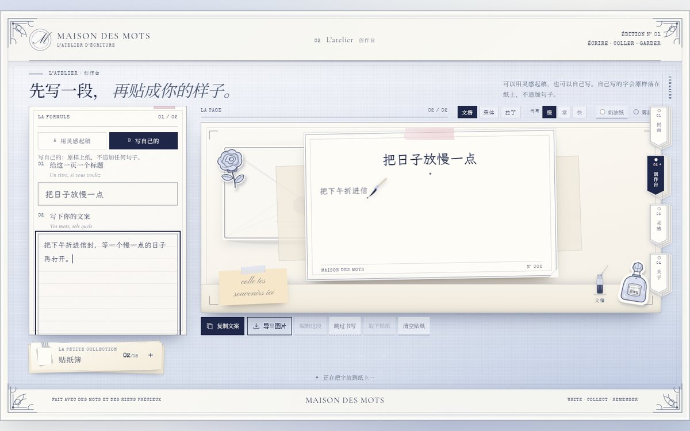

# Maison des Mots Skill

**把「法式纸雕的一屏纸册」写成了一份可以交给 AI 的 Skill。**

它的视觉来源是一个真实落地的项目：[Maison des Mots · 纸里行间](https://github.com/BaxterL/maison-des-mots)
（[在线参观](https://baxterl.github.io/maison-des-mots/)）。一间安静的、可以写字和贴纸的网页纸房间。

`SKILL.md` 把颜色、字体、纸感、层叠、构图、动效配方、组件清单、响应式断点和踩坑记录，
整理成 AI 编码助手可以直接执行的约束，而不是 moodboard，也不是一张很长的展示页施工图。

## 这一版的重点

- **一屏一本**：四页都锁在一屏里（`100dvh`），不做整页滚动；放不下的内容用「册子 / 便签 / 抽屉」展开。
- **换页不翻纸**：页面直接让位，新页元素逐项入场；从菜单回封面也能看到完整入场，不会先出现整页再淡入。
- **创作台是一张桌子**：浅银灰亚麻桌面 + 纸、信封、墨瓶、便签；不是又一块卡片。
- **贴纸簿是物件**：手裁纸册 + 回形针 + 和纸胶带，点开是不规则便签，可拖动、可点选、可直接拖到纸上。
- **纸面字体**：文楷 / 宋体 / 拉丁 / 快乐体 / 黄油体，导出与屏幕用同一张字体表。
- **导出成图**：3× 高清、跟随奶油 / 雾蓝纸色、垫一层浅亚麻底，正文自动缩排、签名不出纸。

## 怎么用

**Claude Code / 其他支持 Skill 的 agent**：把本仓库放进 skills 目录，或直接引用 `SKILL.md`。

**只想快速开始**：把下面这段和 `SKILL.md` 一起丢给 AI。

> 用 `maison-des-mots-art-direction` 的方向，做一个「[你的产品]」的四页纸册应用。
> 保留：奶白 + 银蓝 + 墨蓝的色板，Cormorant Garamond / Pinyon Script / Noto Serif SC / Special Elite / LXGW WenKai 五种字，
> 模切白边 + 1px 墨蓝线的纸感，右侧三层纸签菜单，**一屏一页不滚动**，换页用逐项入场，
> 首屏叠纸拼贴，创作台做一张浅色亚麻桌 + 可展开的贴纸簿，正文用毛笔逐组显影。
> 功能是 [一句话功能]。先给视觉方案，再落 React + Vite + GSAP；所有素材与字体必须本地化。

## 里面有什么

- **设计 token**：色板、字体分层、纸边阴影、字距与行高。
- **页面骨架**：书壳比例、四角花角、页眉、右缘三层纸签、单屏 page-stage、底部 tab。
- **换页配方**：`enter` 状态 + rAF 放开入场；页面挂载即处在起点，避免闪帧。
- **首屏配方**：模切吊牌、档案表盘、雾蓝纸、信笺、邮票与 Souvenir 菱形卡。
- **工作室配方**：亚麻桌、信封、墨瓶与毛笔、双模式、纸面字体、书写速度、贴纸簿。
- **导出配方**：canvas 3× 合成、纸色主题、自动缩排、贴纸序列化。
- **文案逻辑**：「用灵感起稿 / 写自己的」双模式；自己写不追加任何模板句。
- **动效规则**：逐项入场顺序、时长范围，以及什么时候该删掉动效。
- **交互与可访问性**：焦点、aria、8 枚上限、方向键、状态播报。
- **响应式断点**：从 1440×900 到 390×844 的单屏压缩策略。
- **验收清单**：上线前逐条对照。

## 预览

